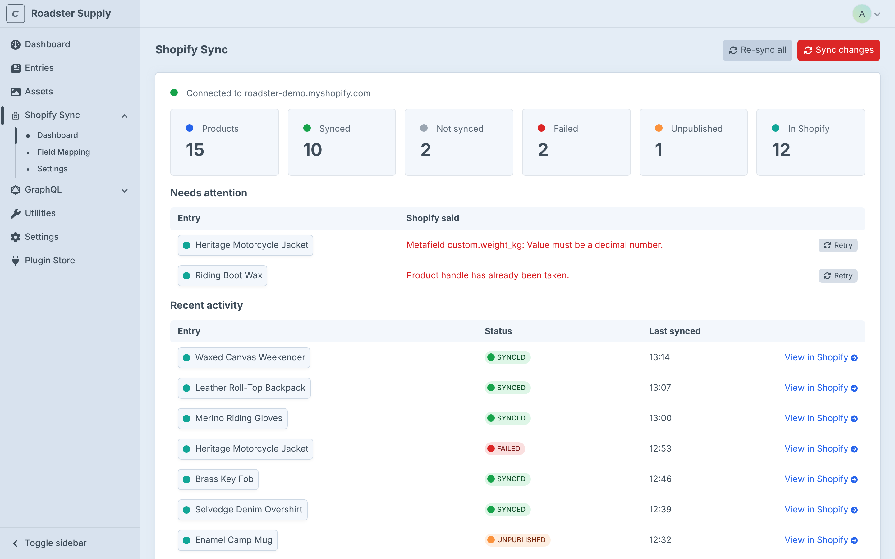
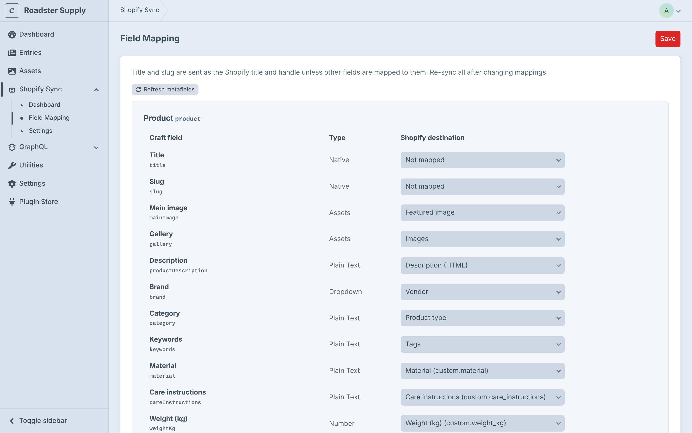
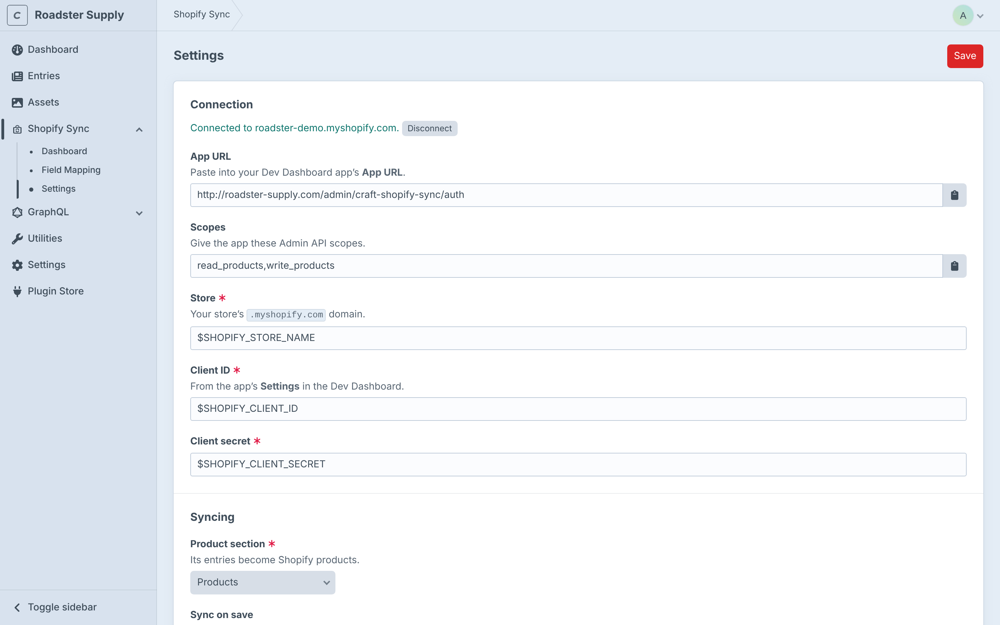
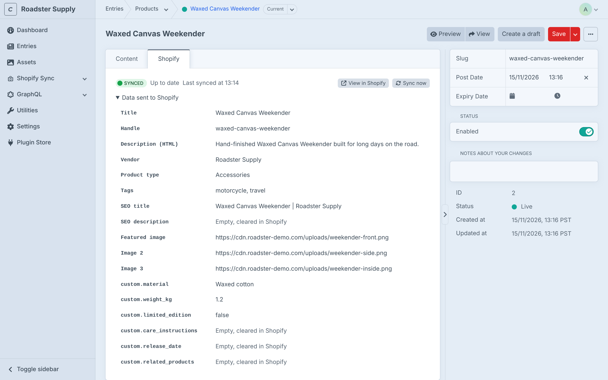

<p align="center"></p>

# Shopify Sync for Craft CMS

Manage your products in Craft and let Shopify keep up. Shopify Sync turns the entries in a section into Shopify
products, and sends any Craft field to a product attribute or metafield.

Craft is the source of truth: edits made to synced data directly in Shopify are overwritten on the next sync.



## Features

- **Any section, any field.** Choose which section's entries become products, then send any field to the title,
  description, vendor, product type, tags, SEO fields or any metafield.
- **Images from Craft.** Map an Assets field to the featured image and another to the rest of the gallery. Images are
  only re-uploaded when they change.
- **Always know where an entry stands.** Each product's Shopify tab shows whether it's synced, up to date or has
  unsynced changes, any error from Shopify, and exactly what will be sent.
- **Status in the entries list.** The product section's entry index shows each entry's Shopify status and when it
  last synced.
- **Sync from anywhere.** On save, per entry, in bulk from the entries index, from the dashboard or the console.
- **Smart conversion.** Dates, numbers, lightswitches, rich text, dropdowns, relations, assets and links to other
  synced products are converted to the formats Shopify expects.
- **Fast, whatever the catalogue size.** Everything runs in Craft's queue, unchanged products are skipped, and full
  syncs are batched.
- **Live dashboard.** Counts update as syncs run, and anything Shopify rejected is listed with its error and a
  **Retry** button.
- **Safe deletes.** Deleted entries unpublish their product (or delete it, if you prefer), and restoring the entry
  brings it back.

| Field mapping | Settings | Shopify tab on an entry |
|---|---|---|
|  |  |  |

## Requirements

- Craft CMS 5.9 or later, and PHP 8.2 or later
- A Shopify store where you can install an app
- Craft's queue running (the default works; a `queue/listen` daemon is best in production)

## Installation

Search for “Shopify Sync” in the Plugin Store, or run:

```bash
composer require roadsterworks/craft-shopify-sync
php craft plugin/install craft-shopify-sync
```

## Connecting to Shopify

Shopify Sync connects through an app you create in Shopify's Dev Dashboard, using Shopify's standard OAuth flow: you
approve the app once, and Craft keeps a permanent access token.

> [!NOTE]
> Creating apps needs a [Shopify Partner](https://www.shopify.com/partners) organisation. You also need to own the
> store, be a collaborator on it with the **App developer** role, or be using a dev store from your Partner organisation.

**1. Create the app**

1. In Shopify, open the account menu (top right) and choose **Dev Dashboard**, then **Create app**.
2. Give it a name, such as *Craft CMS*, and create its first version:
   - **App URL:** copy it from **Shopify Sync → Settings** in Craft. It looks like `https://example.com/admin/craft-shopify-sync/auth`.
   - **Embed app in Shopify admin:** off.
   - **Scopes:** `read_products,write_products`
   - Leave **Use legacy install flow** off.
3. **Release** the version.
4. On the app's **Settings** screen, copy the **Client ID** and **Secret**.

**2. Limit it to your store**

1. From the app's **Home** screen, choose **Select distribution method**, then **Custom distribution**.
2. Enter your store's `.myshopify.com` domain and generate the link. (The app is then locked to that store.)

**3. Add the credentials to Craft**

```env
SHOPIFY_STORE_NAME="your-store.myshopify.com"
SHOPIFY_CLIENT_ID="…"
SHOPIFY_CLIENT_SECRET="…"
```

In **Shopify Sync → Settings**, enter `$SHOPIFY_STORE_NAME`, `$SHOPIFY_CLIENT_ID` and `$SHOPIFY_CLIENT_SECRET`, choose
your product section and save.

**4. Authorise**

Click **Authorise in Shopify** on the settings page and approve the app. You're sent back to Craft, connected.

The access token is stored encrypted in the database. To use the same connection in another environment (one Shopify
can't redirect to, like your local site), run this where you authorised and add the output to the other `.env`:

```bash
php craft craft-shopify-sync/auth/token
```

## Mapping fields

In **Shopify Sync → Field Mapping**, choose where each Craft field goes in Shopify:

- **Product attributes:** title, handle, description, vendor, product type, tags, SEO title and description. The entry's
  title and slug are used for the title and handle unless you map other fields to them.
- **Images:** map an Assets field to **Featured image** (its first image is used) and/or **Images** (all of them, after
  the featured image). Once images are mapped, Craft manages the product's media: when they change in Craft, the
  product's images are replaced in order. Shopify downloads each image, so assets need public URLs.
- **Metafields:** choose one of your store's metafield definitions, or **Custom metafield…** to enter a namespace, key
  and type. Click **Refresh metafields** after adding definitions in Shopify.

Each destination can only be used once per entry type. When a mapped field is empty, the value is cleared in Shopify.
After changing mappings, click **Re-sync all** on the dashboard.

### Checking a mapping works

1. **On save:** mappings are checked against Shopify. A custom metafield must use the same type as any definition
   already in Shopify, and invalid namespaces, keys or duplicate destinations are rejected.
2. **Before syncing:** open a product entry's **Shopify** tab and expand **Data sent to Shopify**. It lists every
   value exactly as it will be sent.
3. **After syncing:** if Shopify rejects a value, the product is marked **Failed**. Shopify's error message is shown on
   the dashboard and the entry, for example *“Metafield custom.weight_kg: Value must be a decimal number.”*

How values are converted:

| Craft field | Sent to Shopify as |
|---|---|
| Plain text, CKEditor | Text. HTML is kept for the description, and converted for rich text metafields. |
| Dropdown, radio buttons, checkboxes | The option labels |
| Lightswitch | `true` or `false` |
| Number | An integer or decimal |
| Date | `date` or `date_time` |
| Entries, categories, tags | Their titles (or Shopify product IDs, for product reference metafields) |
| Assets | Product images (for image destinations), otherwise their URLs |
| Tables and other structured data | JSON |

## How syncing works

| In Craft | In Shopify |
|---|---|
| Save a product entry | The product is created, or updated if anything changed |
| Delete an entry | The product is unpublished (or deleted, if you choose that in the settings) |
| Restore an entry | The product is updated, with its status set by **New products** |

Drafts and bulk resaves don't sync; use **Sync changes** on the dashboard, or select entries in the product section and
choose **Sync to Shopify**. Failed syncs are retried three times.

You can also queue syncs from the command line:

```bash
php craft craft-shopify-sync/sync/all           # changed products
php craft craft-shopify-sync/sync/all --force   # every product
php craft craft-shopify-sync/sync/entry 123     # one entry
```

Logs are written to `storage/logs/craft-shopify-sync-YYYY-MM-DD.log`.

## Settings

| Setting | |
|---|---|
| Store, Client ID, Client secret | Your app's credentials. Use environment variables. |
| Product section | Its entries become products. The Shopify tab is added to its entry types automatically. |
| Sync on save | Sync product entries when they're saved (on by default). Only entries with changes are sent. |
| New products | Created as *Live* or *Unpublished*. Disabled entries are always unpublished. |
| Deleted entries | *Unpublish* the product (recommended) or *Delete* it. |

Settings and mappings live in project config, so set them up locally and deploy them as usual.

## Permissions

Give editors **Sync products** to use the dashboard and **Sync now**. **Manage field mapping**, **Manage settings** and
**Delete all Shopify products** are for admins.

## Troubleshooting

| Problem | Try |
|---|---|
| “Not connected yet” | Check the store, client ID and secret, then click **Authorise in Shopify**. |
| Authorisation fails | The **App URL** in the Dev Dashboard must match the one in the settings exactly, and the app must be released. |
| “Access was revoked” | The app was uninstalled or its token revoked. Authorise again. |
| Nothing happens after saving | **Sync on save** is on, the entry is in the product section, and the queue is running. |
| A metafield isn't listed | Click **Refresh metafields**, or use **Custom metafield…** |

## Uninstalling

```bash
php craft plugin/uninstall craft-shopify-sync
```

This removes the Shopify tab and the plugin's database tables. Your Shopify products aren't touched.

The dashboard's **Danger zone** can delete every product in your store, which is handy for resetting a dev store.
It can't be undone.

## Licence and support

Shopify Sync is a commercial plugin under the [Craft License](LICENSE.md). It's free to try in development; buy a
licence from the Plugin Store for each live site.

Report bugs and request features on [GitHub](https://github.com/roadsterworks/craft-shopify-sync/issues), or email
[roadsterworks@gmail.com](mailto:roadsterworks@gmail.com).
